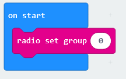
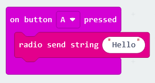
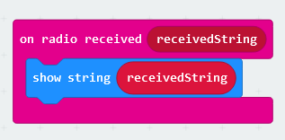
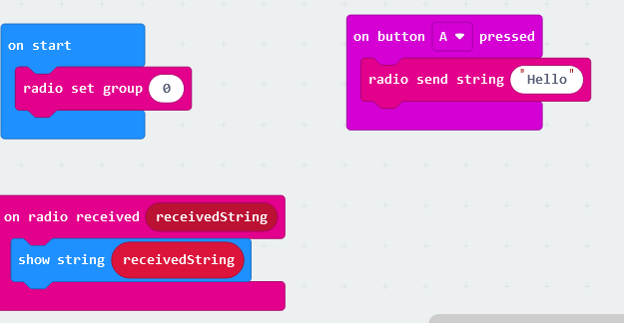
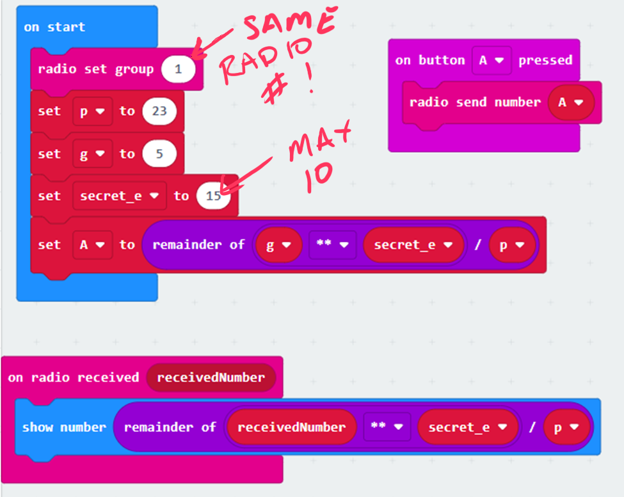

# Diffie Hellman 

## Student materials:

A Microbit and a card with the following information:
* "Public" information:
  * Radio group (number 0-83, should be pairs)
  * Two integers: `p` and `g`
* Top Secret" information:
  * Small list of words to choose from

A PDF of some cards is in this repo

## Preparation checklist:

* Computers logged in and Chrome/Edge (not Firefox) opened to [Makecode](https://makecode.microbit.org)
* Microbits plugged into computer.  If there is time, do an initial pairing to make sure code uploads go smoothly
* Instructor has a microbit listening on a channel to snoop

## Background

* Embedded/hardare program is an important part of infrastructure
  * "Smart" devices, environment monitoring, etc
* Hardware in the MIcrobit is a smaller version of what's in a smartphone, with some added nice things
  * This is "real" hardware, just packaged for education
* Security in the Internet of Things is serious
  * 2016: Mirai was (at the time) the largest botnet DDoS attack, source code is available and growing
  * Exploited poor security in small embedded and connected devices to take over them and flood targets with requests

## The code

Similar to [Micro:bit chat tutorial](https://www.youtube.com/watch?v=egTeIghYXak):

I plan to run the code in my browser so they can see what they should see instead of uploading it to my own Micro:bit

1. Initial programming steps
  1. Set radio channel (have students use the number on their card). THis makes sure that only the Micro:bits set to the same channel (ideally, their neighbor) talk to each other.

  1. When the button is pushed, send a message. Have them choose one of the secret words on their card.

  1. When a message is received, display the message.

1. After the code is written, students can investigate what the Python would look like (Blocks/Pyhthon selector at top).
1. Download the code to the Micro:bits using Chrome and the big purple Download button

# The takeaway, and how to fix it:

Securign transmissions is important (thus crypto and passwords).
I usually have a Micro:bit set to one of the channels so I can ask a group if their word was something specific.

We can take precautions to make sure the message read by the attacker is useless.
One way is creating secret keys even over insecure channels.  
Ralph Merkle devised a scheme which is named after Diffie and Hellman (Diffie Hellman Key Exchange.
The idea is to use publicly available info and secret values known only to you to create an integer "password" that only you and the person you are communicating with know: .

# Building DHKE

1. Create variables `p` and `g`, using the numbers on the cards
1. Create another variable named `secret_e` and set it to a positive integer of the student's choosing (between 1 and 10 inclusive).  Don't tell anyone!
1. Create a variable named `A` that has the value `g ** secret_e % p` (`g` to the power of `secret_e` mod `p`).
  * To get the power operator, you need to get a basic arithmetic operator and change it to `**`
1. When the button is pressed, send the value `A`
1. When the radio receives a number, generate the secret number by calculating (and showing) `receivedNumber ** secret_e % p`
1. Upload the code to the Micro:bits and run it.  Does your secret number match your neighbor's?

## The explanation

Wiki explains it well, I like it's paint bucket explanation; you may want to bring it up on the screen.
