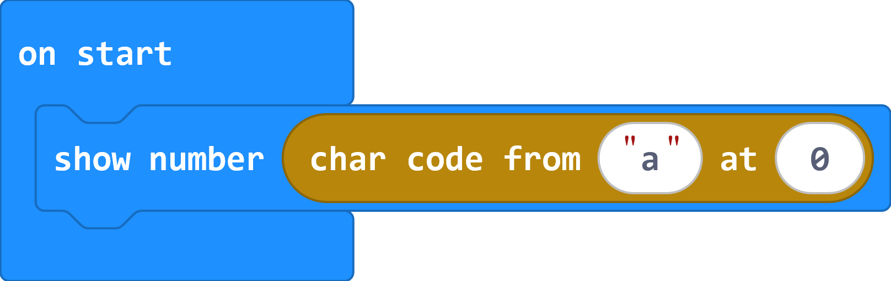
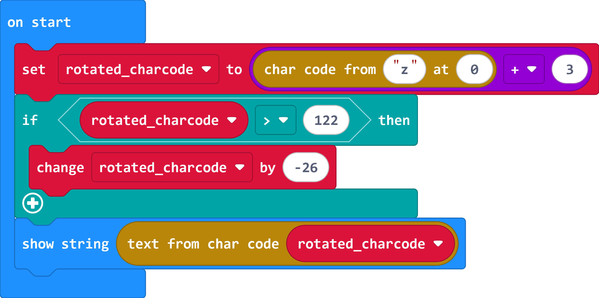
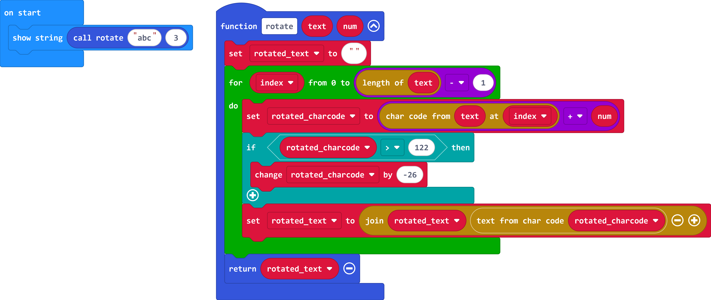
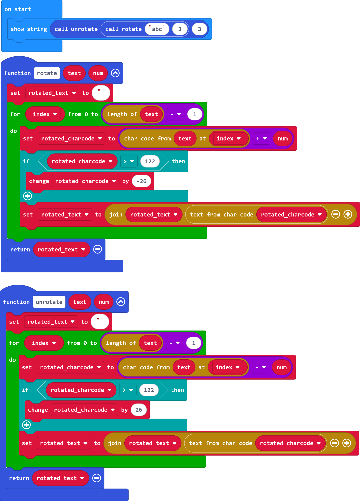
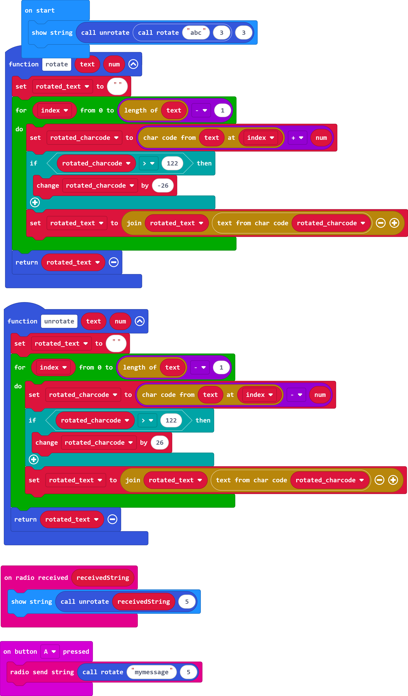

# "Encryption" by rotation

## Goals

Students will
* Use the following programming structures and concepts
    * Functions
    * Loops
    * Conditionals
    * Basic Arithmetic
    * Basic string maniuplation
* Show the relationships between characters and their encodings (ASCII)
* Investigate basic encryption/decryption techniques

## Outline

1. Introduction key points
    * Wireless (and wired) communication can be snooped on
    * Encryption is one way to protect your data from being spied on
    * Encryption works on numbers, but that's OK because _everything is a number
1. Characters are represented to the computer as integers
    * Bring up ASCII/CP1252 chart
    * Demonstrate on the microbits with the following:
    
1. A simple way to "encrypt" data is by rotating the charactes in a given direction
    * I never said it was a good encryption method
    * Decoder ring picture here
1. To rotate a character by a number of letters you can just add that to the character code and convert it back to a letter
    * Make a new variable called `rotated_charcode`
    * Set to to the charcode of your the letter + your rotation amount (example rotates at 3)
    * If we go past `z` (character code is `97+26=122`) subtract 26 (the number of letters in the alphabet)
    
1. Make a function to handle rotating every character of a string (we'll assume single words, no spaces or special characters)
    * Create a function named rotate with two variables: `text` and `num`
    * Create the variable `rotated_text` and initialize it to the empty string at the beginning of the function (empty string value is under Text in Advanced)
    * Loop through the indices of the string (the loop is inclusive at both ends, so make sure to do length-1 as your end point)
    * Move the code (except the show string which can be deleted) from on start to the function in the loop.  Change the specific string in char code to `text`, the index to `index`, and the offset to `num`
    * After the if statement, make `rotated_text` be `rotated_text` joined with the character from the rotated charcode
    * Return the rotated text
    
1. Copy the rotate function to an unrotate function.  Change the following:
    * subtract num instead of adding num
    * If rotated_charcode < 97, add 26
    
1. If time, decide on a rotation number with your neighbor (between 1 and 25 inclusive) and send messages over the radio (perhaps on button press)
    * Change the number you rotate and unrotate to whatever you and your neighbor decide on
    