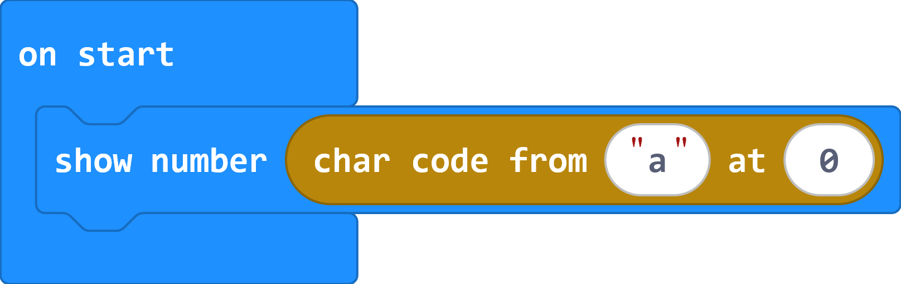
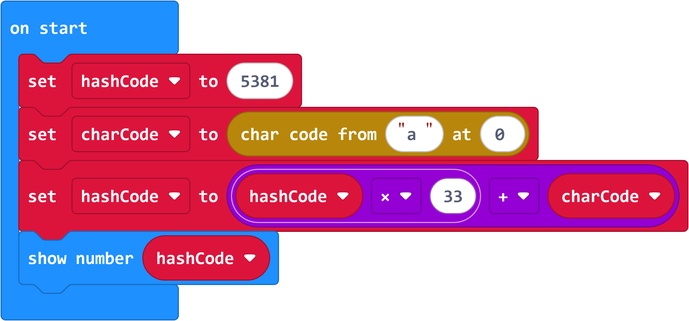
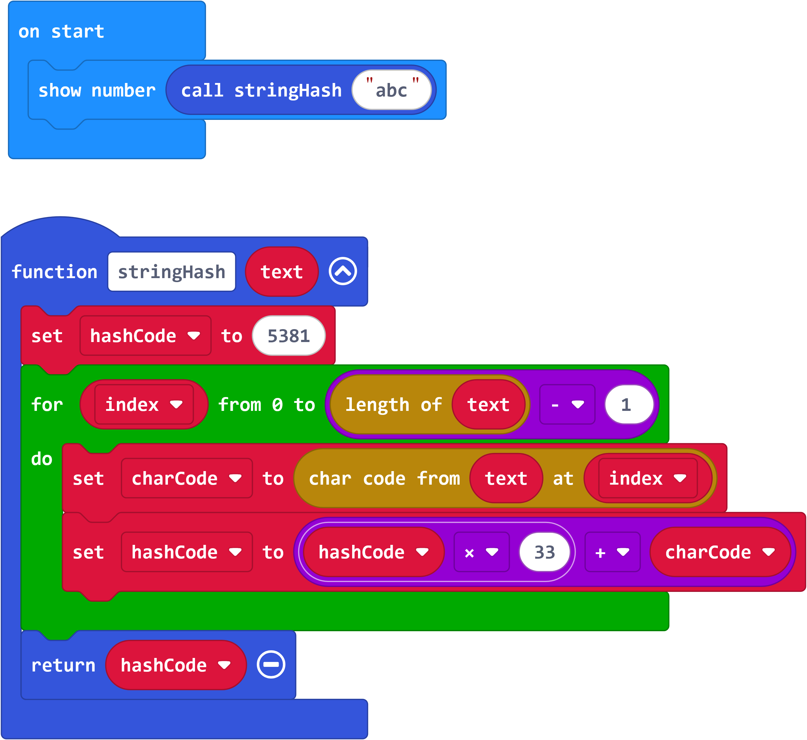
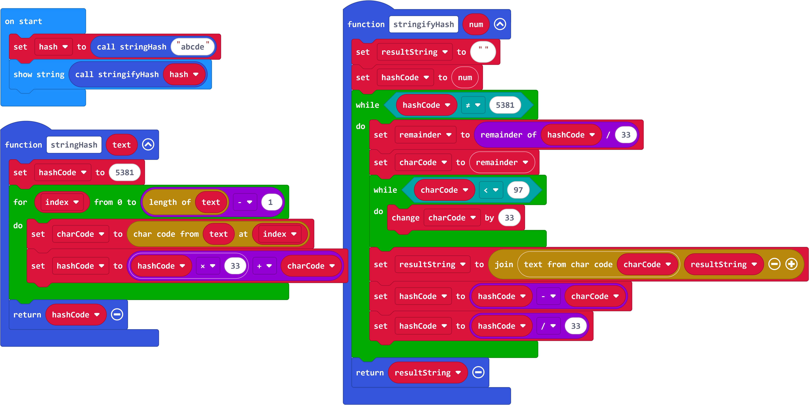

# String Hashing and Passwords

## Outline

* Storing passwords as plain text is a Bad Idea (tm)
* Using reversable encryption to "protect" a password is not useful; better to use a one way operation
* Hash Functions turn an object (such as a string of characters) into an integer representation of that object
* Hash Functions can have a variety of qualities that make them better suited to different tasks

1. Characters are represented to the computer as integers
    * Bring up ASCII/CP1252 chart
    * Demonstrate on the microbits with the following:
    
1. One possible simple hash function: [djb2](http://www.cse.yorku.ca/~oz/hash.html) 
    * The comment explains a way to do it without bitshifting
1. Demonstrate hashing a single character string:
    * Make a variable called `hashCode`, with an initial value of 5381
    * Make a variable called `charCode`, and get its character code
    * Update `hashCode`'s value to be `33*hashCode+charCode`
    
1. Create a function that takes a string, iterates through it, and builds the hash
    * Move blocks into function and loop through the indices
    * This would be a good place to explain zero indexing and arrays
    
1. Have students pick a word (all lower case) and determine the hash code

This is one easy stopping poing, depending on time.
We can continue to show that this isn't a great hash function for cryptographic purposes.

1. Since we used only lowercase letters, we know that the ascii values are somewhere between 97 and 122.  We also know the starting point
    * This means we can easily reconstruct the string by determining the remainder when we integer divide by 33, using that to figure out what letter was, and reverse the hash
    * The procedure is... weird, but this works (assuming lowercase letters)
    

This can lead to conversations regarding:
* Password strength requirements
* Cryptographic hashes vs non-cryptographic hashes
